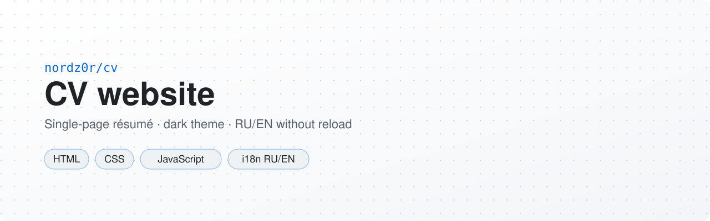

  <picture>
    <source media="(prefers-color-scheme: dark)" srcset=".github/assets/banner-dark.svg">
    <source media="(prefers-color-scheme: light)" srcset=".github/assets/banner-light.svg">
    
  </picture>

<b>Русский</b> · <a href="README.en.md">English</a>

  
  
  

Одностраничный сайт-резюме в стиле DevOps/Tech с тёмной темой, анимациями и поддержкой двух языков (RU/EN).

## Особенности

- Современный тёмный UI с акцентами
- Sticky-навигация и якорные переходы
- Анимации появления секций и typewriter-эффект
- Вертикальный timeline опыта работы
- Адаптивная вёрстка (включая мобильное меню)
- Переключение языка RU/EN без перезагрузки
- Автоматический расчёт возраста и опыта
- SVG favicon

## Структура проекта

- `index.html` — разметка страницы
- `style.css` — стили и адаптив
- `script.js` — логика интерфейса, анимации, i18n-переключение
- `i18n.js` — словари переводов RU/EN

## Запуск

Откройте `index.html` в браузере.

Для корректной работы через локальный сервер можно использовать, например, VSCode Live Server.

## Кастомизация

### Тексты

Изменяйте словари в `i18n.js`:

- `translations.ru` — русский язык
- `translations.en` — английский язык

### Стили

Основные переменные темы находятся в `:root` в `style.css`.

### Контент

Секции и структура карточек редактируются в `index.html`.

## Контакты кандидата

- Контакты намеренно собираются в рантайме на странице (`script.js`), чтобы усложнить автоматический парсинг.
- Используйте кнопки **Email**, **Telegram**, **Habr Career** на странице резюме.

## Лицензия

MIT, см. [LICENSE](LICENSE).
